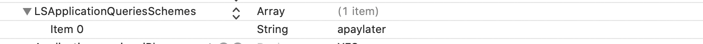

# AtomeMerchantDemo-iOS
Atome Merchant iOS Demo 

## Integration

#### CocoaPods (iOS 10+)

You can use [CocoaPods](http://cocoapods.org/) to install `AtomeSDK` by adding it to your `Podfile`:

```ruby
platform :ios, '10.0'
use_frameworks!

target 'YourApp' do
    pod 'AtomeSDK'
end
```

**add "Queried URL Schemes" to your info.plist, type is "Array",add a string value "apaylater"**

eg.


#### Swift Package Manager (iOS 10+)

You can also use [Swift Package Manager](https://www.swift.org/documentation/package-manager/) to install `AtomeSDK` (version `0.1.2`).

In Xcode, go to **File > Add Package Dependencies...**, enter the repository URL below, and set the dependency rule to **Exact Version** `0.1.2`:

```
https://github.com/Atome-FE/AtomeMerchantDemo-iOS.git
```

Or, if you manage dependencies in a `Package.swift` manifest, add the following:

```swift
dependencies: [
    .package(url: "https://github.com/Atome-FE/AtomeMerchantDemo-iOS.git", exact: "0.1.2")
],
targets: [
    .target(
        name: "YourTarget",
        dependencies: [
            .product(name: "AtomeSDK", package: "AtomeMerchantDemo-iOS")
        ]
    )
]
```

Remember to complete the **Queried URL Schemes** step above (add `apaylater` to your `Info.plist`) when using Swift Package Manager as well.


## Usage
Swift
```swift
// open an atome link to open atome app
AtomeManager.shared().handPaymentURL(url)
```

```swift
if AtomeManager.shared().isAtomeInstalled() {
    debugPrint("Atome already installed")
} else {
    debugPrint("Atome not installed, please go to download")
}
```
Objective-C
```
// open an atome link to open atome app
[[AtomeManager sharedManager] handPaymentURL:url options:nil completionHandler:nil];
```

```
if ([[AtomeManager sharedManager] isAtomeInstalled]) {
    NSLog(@"Atome already installed");
} else {
    NSLog(@"Atome not installed, please go to download");
}
```


## Note

if your project is written by Objective-C, please create Bridging-Header.h
